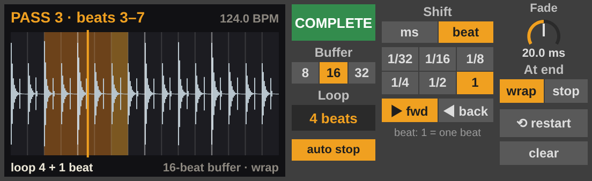

# Loopshifter for Max for Live

An Ableton Live **audio effect** that captures a tempo-synced buffer and plays a short loop
from it. After each pass the loop's window moves a little further through the buffer, and
the material stays on the beat.



*(the display is drawn by the real display script from the real engine; the controls
beside it are a drawing of the layout)*

## The idea

Capture 16 beats, `ABCDEFGHIJKLMNOP`. Set **Loop** to 4 beats and **Shift** to 1 beat.
Loopshifter plays the loop plus the shift, then starts again one shift later:

```
ABCDE  BCDEF  CDEFG  DEFGH  EFGHI ...
```

Every pass lasts loop + shift, and the next one starts later by the same shift, so every
hit stays on its beat, whatever the shift is, even an odd number of milliseconds. Only the
place where it jumps moves around. That's where the stuttery edits come from.

**Backwards** starts on the last loop of the buffer and plays loop minus shift, then steps
back by the shift: `MNO  LMN  KLM ...`. That's the backwards version that stays on the beat.
Because it plays loop minus shift, the shift has to be shorter than the loop.

## Install

Put **Loopshifter.amxd** and **loopshifter_display.js** in the same folder (for example
`User Library/Presets/Audio Effects/Max Audio Effect/`) and drag Loopshifter.amxd onto an
audio track, a group or a return. `loopshifter_display.js` draws the display. To get one
file that carries everything, open the device in Max and press **Freeze Device**.

## Playing it

1. With Live stopped, press **CAPTURE**. The display says *ARMED: starts with Play*.
2. Press Play in Live. Recording starts on the very first sample, wherever you start
   from (the display counts the beats in red), and the loop starts as soon as the buffer
   is full.
   If you press **CAPTURE** while Live is already playing, it waits for the next bar line
   instead.
3. Change **Loop**, **Shift** and the direction while it plays. Each change takes effect at
   the next jump.
4. **Restart** goes back to the first window on the next bar line.
5. Press **CAPTURE** again to record a new buffer. You hear the track while it records.

Before a capture, and after a **stop**, you hear the track as normal. When Live stops,
the buffer is kept, and the next time Live plays, the loop starts again from the top. If
you start from the same place you captured from (usually a bar line), it starts straight
away.

## Controls

| Control | What it does |
|---|---|
| **CAPTURE** | Arms the capture. Live stopped: recording starts when you press Play. Live playing: it starts on the next bar line. Records 8, 16 or 32 beats. |
| **Buffer** | How many beats to capture: 8, 16 or 32. |
| **Loop** | Loop length, from 1 to 16 beats. |
| **Shift: ms / beat** | Set the shift in milliseconds (a knob, 1 to 2000 ms) or as a fraction of a beat. |
| **1/32 ... 1** | Shift as a fraction of a beat: 1 = one beat, 1/4 = a sixteenth note, 1/32 = a very small nudge. |
| **fwd / back** | Which way the window moves through the buffer. |
| **Fade** | Crossfade at each jump, from 0 to 40 ms (20 ms by default). 0 gives hard, clicky edits. |
| **At end: wrap** | The window runs on past the end of the buffer and comes round to the start (`MNOPA`), still on the beat. |
| **At end: stop** | Once the next window would run past the end (or before the start, going back), the loop stops and you hear the track again. |
| **Restart** | Back to the first window, on the next bar line. |

Every control is a Live parameter, so Key Map (Cmd/Ctrl+K), MIDI Map (Cmd/Ctrl+M) and
automation all work. For example, automating **Restart** at the start of each section, or
the **Shift** fraction across a breakdown.

## Ideas for loop fatigue

- **Slow drift:** a 32-beat buffer with a 4-beat loop and a 1/16 shift. It takes a long time
  to get through the buffer, so the groove changes gradually over a whole section.
- **Off-grid edits:** set Shift to ms (try 37 ms or 113 ms). The hits stay on the beat,
  but the jump lands in odd places, which gives you Autechre-style stutters.
- **Build and release:** use **stop** with a 2-beat loop and a 1/2 shift. The window runs
  through the buffer and then hands back to the live track. Automate Restart to set it off
  again.
- **Back and forth:** automate fwd/back every 8 bars, and the window wanders around the
  middle of the buffer.

## Notes

- Assumes 4/4. The loop remembers where in the bar the capture started (normally the bar
  line), and Restart waits for that point, so the loop stays lined up with the bars.
- The buffer remembers the tempo it was captured at. If you change Live's tempo after
  capturing, capture again.
- The window, the play head and the beat it's on are shown in the display. The status
  line says when it's waiting for a bar.

## Files

- `m4l/loopshifter.genexpr`: the engine (it goes in the gen~ codebox)
- `m4l/loopshifter_display.js`: the display ([jsui])
- `m4l/build_device.py`: writes `m4l/dist/Loopshifter.amxd` (and a `.maxpat` copy to read in Max)
- `m4l/test/gen_test.js`: turns the GenExpr into JavaScript and checks the playback order
  (ABCDE BCDEF..., ms shifts, backwards, wrap, stop, restart, transport, fades,
  arming while Live is stopped):
  `node m4l/test/gen_test.js`
